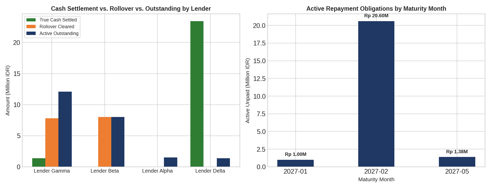

# Loan Portfolio Reconciliation & Cash vs. Rollover Analytics

An end-to-end data reconciliation and portfolio analytics case study across **24 loan records** (Oct–Nov 2026) from two loan tracking sources, sanitized for public portfolio presentation.

## Key Highlights
- **Gross Disbursed (24 Loans):** IDR 63,601,000 (Avg: IDR 2,650,042 | Median: IDR 2,200,000 | Avg Tenor: 115.8 days)
- **True Cash Settled:** IDR 24,821,000 (**39.0%** of disbursed across 6 fully paid loans)
- **Rollover Cleared (Non-Cash Replacement):** IDR 15,800,000 (**24.8%** across 7 restructured loans rolled into new contracts)
- **Active Outstanding Balance:** IDR 22,980,000 (**36.1%** across 11 active loans; all 24 loans at 0 DPD)

## Data Audit & Reconciliation Findings
1. **Missing Detail Rows Reconciled:** Identified 3 loan records (`LN-01`, `LN-06`, `LN-17`, IDR 500,000 each = **IDR 1,500,000**) present in summary totals and the internal ledger but omitted from the detail sheet, restoring full reconciliation to 24 loans.
2. **Separating Cash Payoff from Rollovers:** Standard repayment totals combine cash settlements with contract rollovers. Separating the two prevents overstating cash recovery (39.0% true cash vs. 63.9% gross repaid/rolled).
3. **Liquidity & Maturity Concentration:** **89.6% of active unpaid principal (IDR 20,600,000 across 8 loans)** matures in **February 2027**, led by **Lender Gamma** (IDR 12,100,000 active unpaid) and **Lender Beta** (IDR 8,000,000 active unpaid).

## Visual Overview

## Workbook Structure (`data/Loan_Portfolio_Reconciliation_Case_Study.xlsx`)
- `01_Executive_Dashboard` — KPI cards, economic breakdown, lender snapshot, and unpaid exposure chart.
- `02_Master_Loan_Ledger` — 24 consolidated loans with automated tenor, days to maturity, cash/rollover split, and ticket size tiers.
- `03_Institution_Risk_Perf` — Lender concentration, cash recovery rate, average tenor, and comparison chart.
- `04_Maturity_Liquidity` — Monthly and chronological repayment obligations for active unpaid loans.
- `05_Vintage_Size_Cohorts` — Origination month cohort (Oct vs. Nov 2026) and loan ticket size segmentation.
- `06_Data_Audit_Privacy` — Reconciliation log and PII/identifier masking rules.
- `07_Contacts_Anonymized` — Sanitized emergency contact cross-linkage table.

> **Privacy Note:** All personal identifiers, contact details, and institution names have been anonymized/masked for portfolio demonstration purposes.
